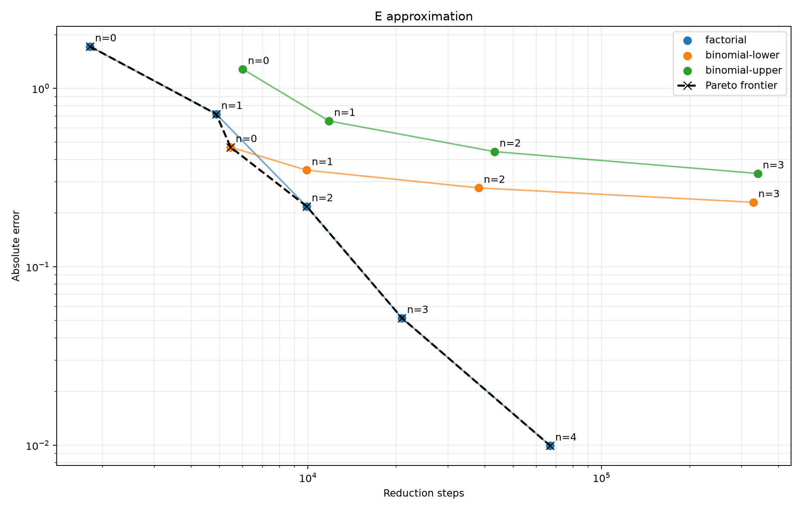

# 自然常数构造算法比较

## 阶乘级数构造

第 $n$ 项为：

$$
\boxed{
\sum_{k=0}^{n}\frac{1}{k!}
}
$$

实现在 [factorial.lambda](factorial.lambda) 中。

## 二项式下界构造

第 $n$ 项为：

$$
\boxed{
\left(1+\frac{1}{n+2}\right)^{n+2}
}
$$

实现在 [binomial-lower.lambda](binomial-lower.lambda) 中。

## 二项式上界构造

第 $n$ 项为：

$$
\boxed{
\left(1-\frac{1}{n+2}\right)^{-(n+2)}
}
$$

实现在 [binomial-upper.lambda](binomial-upper.lambda) 中。

## 比较并绘图

在仓库根目录运行：

```sh
uv run scripts/compare_real.py examples/e \
  --exact-value 2.71828182845904523536028747135266249775724709369996 \
  --max-index 10 --max-steps 1000000
```

得到的表格为：

[steps-vs-error.csv](steps-vs-error.csv)

得到的图片为：



可知按精度与步数之比来评估，最好的是阶乘级数构造算法。
