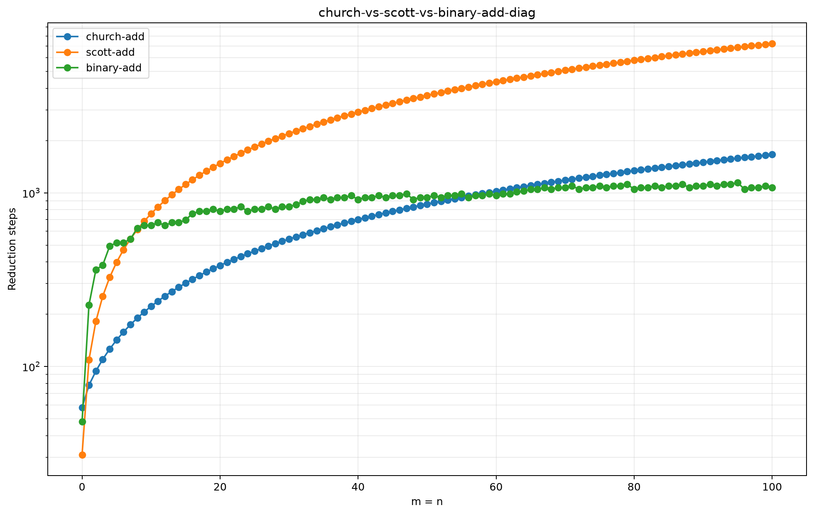
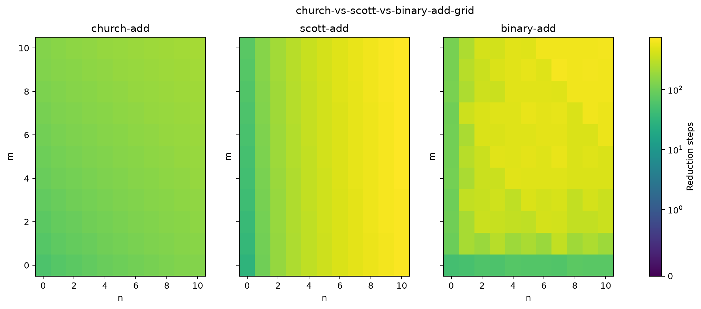
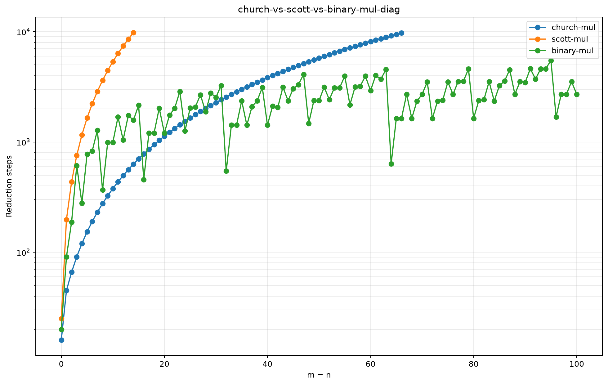
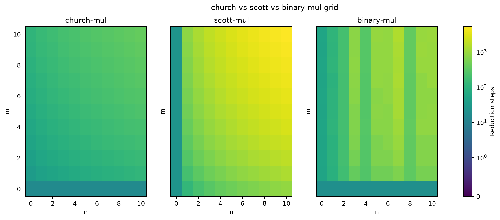
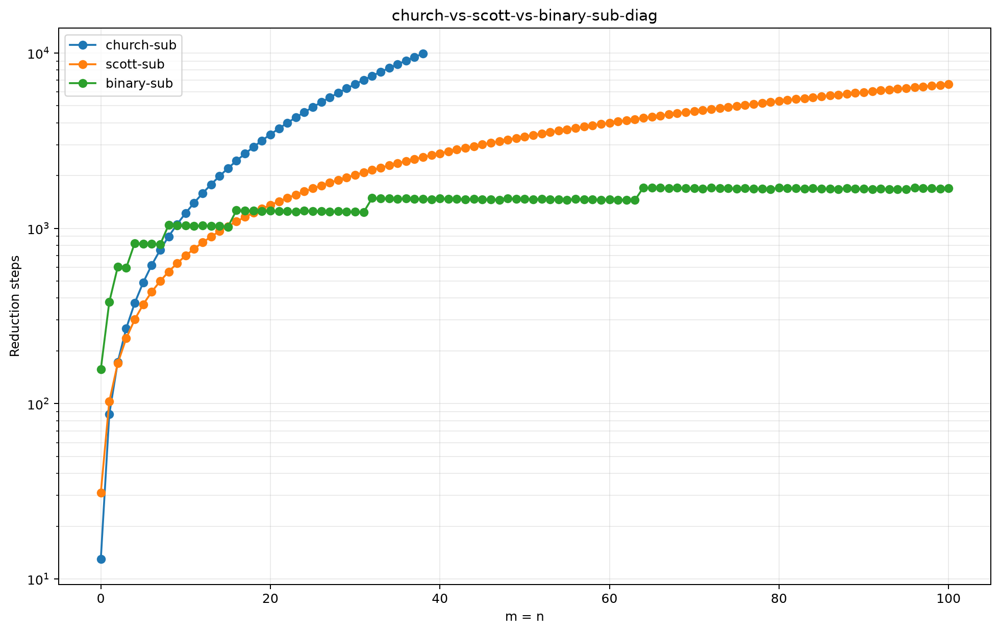
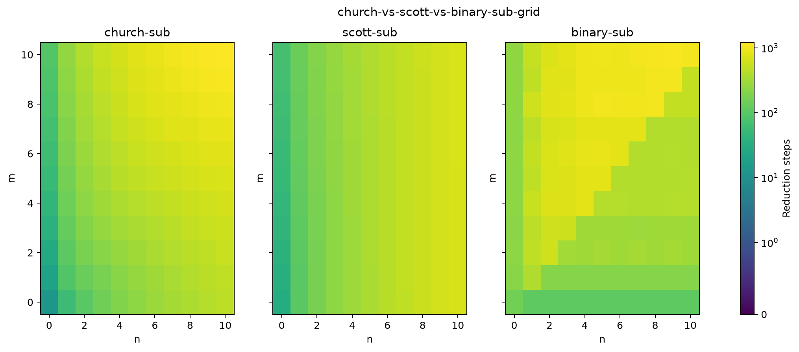
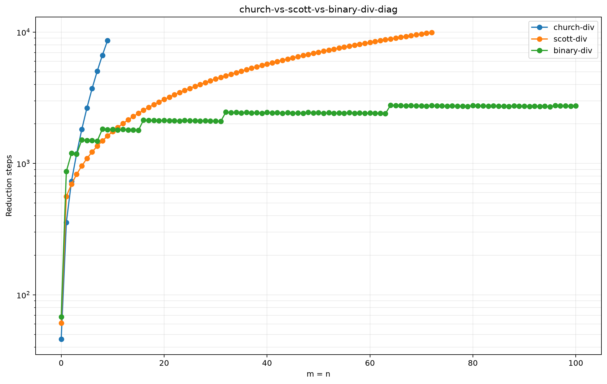
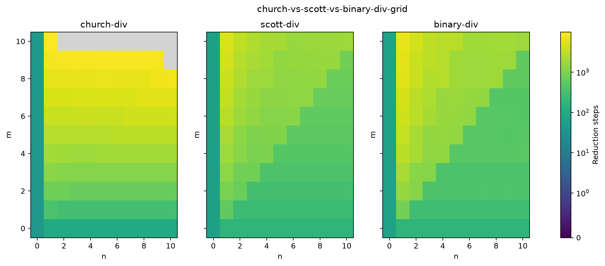

# 自然数编码

## 丘奇编码

丘奇编码通过反复应用函数来表示数据，强调数据的迭代或折叠行为。

丘奇编码及相关运算实现在 [church.lambda](church.lambda) 中。

### 丘奇编码的自然数构造

丘奇编码将自然数 $n$ 表示为函数应用 $n$ 次：

$$
\begin{aligned}
0_C &= \lambda f.\lambda x.x \\
1_C &= \lambda f.\lambda x.f\ x \\
2_C &= \lambda f.\lambda x.f\ (f\ x) \\
3_C &= \lambda f.\lambda x.f\ (f\ (f\ x))
\end{aligned}
$$

因此按照皮亚诺公理，丘奇编码的零和后继分别为：

$$
\boxed{
\begin{aligned}
    \mathrm{ZERO}_C &= \lambda f.\lambda x.x \\
    \mathrm{SUCC}_C &= \lambda n.\lambda f.\lambda x.f\ (n\ f\ x)
\end{aligned}
}
$$

前驱可以表示为：

$$
\mathrm{PRED}_C
=
\lambda n.\lambda f.\lambda x.
n\
(\lambda g.\lambda h.h\ (g\ f))\
(\lambda u.x)\
(\lambda u.u)
$$

丘奇编码的自然数可用于表示迭代：

- 当 $n=\mathrm{ZERO}_C$ 时，$n\ a\ b$ 被归约为

    $$
    \begin{aligned}
    \mathrm{ZERO}_C\ a\ b
    &= (\lambda f.\lambda x.x)\ a\ b \\
    &\to b
    \end{aligned}
    $$

- 当 $n=\mathrm{SUCC}_C\ p$ 时，$n\ a\ b$ 被归约为

    $$
    \begin{aligned}
    (\mathrm{SUCC}_C\ p)\ a\ b
    &= ((\lambda n.\lambda f.\lambda x.f\ (n\ f\ x))\ p)\ a\ b \\
    &\to (\lambda f.\lambda x.f\ (p\ f\ x))\ a\ b \\
    &\to a\ (p\ a\ b)
    \end{aligned}
    $$

综上可知：

$$
n\ a\ b
=
\begin{cases}
  b & n = 0 \\
  a\ ((n-1)\ a\ b) & n \ge 1
\end{cases}
$$

继续展开：

$$
(n-1)\ a\ b
=
\begin{cases}
  b & n-1 = 0 \\
  a\ ((n-2)\ a\ b) & n-1 \ge 1
\end{cases}
$$

最终得到：

$$
\boxed{
n\ a\ b
=
\underbrace{a (a (\cdots a}_{n} (b)\cdots))
}
$$

即 $n\ a\ b$ 表示对 $b$ 连续应用 $n$ 次 $a$。

### 丘奇编码的自然数运算

#### 丘奇编码的加法

丘奇编码的加法非常简单，$m+n$ 就是先执行函数 $n$ 次再执行函数 $m$ 次：

$$
\boxed{
\mathrm{ADD}_C
=
\lambda m.\lambda n.\lambda f.\lambda x.m\ f\ (n\ f\ x)
}
$$

#### 丘奇编码的乘法

丘奇编码的乘法更加简单，$m\times n$ 就是把执行函数 $n$ 次的过程重复 $m$ 次：

$$
\boxed{
\mathrm{MUL}_C
=
\lambda m.\lambda n.\lambda f.m\ (n\ f)
}
$$

#### 丘奇编码的减法

丘奇编码的减法会麻烦一些，$m-n$ 可以表示为对 $m$ 连续应用 $n$ 次前驱：

$$
\boxed{
\mathrm{SUB}_C
=
\lambda m.\lambda n.n\ \mathrm{PRED}_C\ m
}
$$

#### 丘奇编码的除法

丘奇编码的除法会更加复杂。

一种方法是用迭代。

把状态表示为一个有序对，第一个数是商，第二个数是余数：

$$
P = (q, r)
$$

初始状态为：

$$
P_0 = (0,m)
$$

状态转移为：

$$
T_n(q,r)
=
\begin{cases}
(q+1,r-n) & r\ge n \\
(q,r) & r<n
\end{cases}
$$

新状态为：

$$
P_{k+1} = T_n(P_k)
$$

从而除法表示为：

$$
\mathrm{div}(m,n)
=
\begin{cases}
    0 & n=0 \\
    \pi_1(P_m) & n\ge 1
\end{cases}
$$

先把状态转移表示成 λ 演算：

$$
\boxed{
\begin{aligned}
\mathrm{trans}
=&
\lambda n.\lambda p. \\
& \mathrm{IF}\ (\mathrm{GEQ_C}\ (\mathrm{SND}\ p)\ n) \\
&\quad (\mathrm{PAIR} \\
    &\qquad (\mathrm{SUCC}_C\ (\mathrm{FST}\ p)) \\
    &\qquad (\mathrm{SUB}_C\ (\mathrm{SND}\ p)\ n)
)\\
&\quad p
\end{aligned}
}
$$

再定义初始状态：

$$
\boxed{
\mathrm{init}
=
\mathrm{PAIR}\ \mathrm{ZERO}_C\ m
}
$$

最后定义除法：

$$
\boxed{
\begin{aligned}
\mathrm{DIV}_C
=&
\lambda m.\lambda n. \\
& \mathrm{IF}\ (\mathrm{ISZERO}_C\ n) \\
&\quad \mathrm{ZERO}_C\\
&\quad \mathrm{FST}\ (m\ (\mathrm{trans}\ n)\ \mathrm{init})
\end{aligned}
}
$$

另一种方法是用递归。不过这和斯科特编码中的除法基本相同，故不再重复。

## 斯科特编码

斯科特编码通过选择构造器对应的分支来表示数据，强调模式匹配和数据结构的拆解。

斯科特编码及相关运算实现在 [scott.lambda](scott.lambda) 中。

### 斯科特编码的自然数构造

斯科特编码需要两个基本定义：

$$
\boxed{
\begin{aligned}
\mathrm{ZERO}_S &= \lambda z.\lambda s.z \\
\mathrm{SUCC}_S &= \lambda n.\lambda z.\lambda s.s\ n
\end{aligned}
}
$$

这分别表示：

$$
\begin{cases}
0 \\
n+1 \\
\end{cases}
$$

由此可以按照皮亚诺公理递归定义所有自然数：

$$
\begin{aligned}
0_S &= \mathrm{ZERO}_S \\
1_S &= \mathrm{SUCC}_S(0_S) \\
2_S &= \mathrm{SUCC}_S(1_S) \\
3_S &= \mathrm{SUCC}_S(2_S)
\end{aligned}
$$

斯科特编码的前驱可以表示为：

$$
\mathrm{PRED}_S=\lambda n.n\ \mathrm{ZERO}_S\ (\lambda p.p)
$$

斯科特编码的自然数可用于表示模式匹配：

- 当 $n=\mathrm{ZERO}_S$ 时，$n\ a\ b$ 被归约为

    $$
    \begin{aligned}
    \mathrm{ZERO}_S\ a\ b
    &= (\lambda z.\lambda s.z)\ a\ b \\
    &\to a
    \end{aligned}
    $$

- 当 $n=\mathrm{SUCC}_S\ p$ 时，$n\ a\ b$ 被归约为

    $$
    \begin{aligned}
    (\mathrm{SUCC}_S\ p)\ a\ b
    &= ((\lambda n.\lambda z.\lambda s.s\ n)\ p)\ a\ b \\
    &\to (\lambda z.\lambda s.s\ p)\ a\ b \\
    &\to b\ p
    \end{aligned}
    $$

综上可知：

$$
n\ a\ b
=
\begin{cases}
  a & n = 0 \\
  b\ (n-1) & n \ge 1
\end{cases}
$$

即 $n\ a\ b$ 表示

- 当 $n=0$ 时执行 $a$
- 当 $n\ge 1$ 时执行 $b\ (n-1)$

### 斯科特编码的自然数运算

#### 斯科特编码的加法

斯科特编码的加法可以使用递归实现：

$$
\mathrm{add}(m, n)
=
\begin{cases}
    m & n = 0 \\
    \mathrm{add}(m,n-1)+1 & n \ge 1 \\
\end{cases}
$$

先表示递归的部分：

$$
\boxed{
\begin{aligned}
\mathrm{recur}
=&
\lambda r.\lambda m.\lambda n. \\
& n \\
&\quad m \\
&\quad (\lambda p.\mathrm{SUCC}_S\ (r\ m\ p))
\end{aligned}
}
$$

然后使用 Y 组合子构造递归：

$$
\boxed{
\mathrm{ADD}_S
=
\mathrm{Y}\ \mathrm{recur}
}
$$

#### 斯科特编码的减法

斯科特编码的减法可以使用递归实现：

$$
\mathrm{sub}(m, n)
=
\begin{cases}
    m & n = 0 \\
    \mathrm{sub}(m,n-1)-1 & n \ge 1 \\
\end{cases}
$$

先表示递归的部分：

$$
\boxed{
\begin{aligned}
\mathrm{recur}
=&
\lambda r.\lambda m.\lambda n. \\
& n \\
&\quad m \\
&\quad (\lambda p.\mathrm{PRED}_S\ (r\ m\ p))
\end{aligned}
}
$$

然后使用 Y 组合子构造递归：

$$
\boxed{
\mathrm{SUB}_S
=
\mathrm{Y}\ \mathrm{recur}
}
$$

#### 斯科特编码的乘法

斯科特编码的乘法可以使用递归实现：

$$
\mathrm{mul}(m, n)
=
\begin{cases}
    0 & n = 0 \\
    \mathrm{mul}(m,n-1)+m & n \ge 1 \\
\end{cases}
$$

先表示递归的部分：

$$
\boxed{
\begin{aligned}
\mathrm{recur}
=&
\lambda r.\lambda m.\lambda n. \\
& n \\
&\quad \mathrm{ZERO}_S \\
&\quad (\lambda p.\mathrm{ADD}_S\ (r\ m\ p)\ m)
\end{aligned}
}
$$

然后使用 Y 组合子构造递归：

$$
\boxed{
\mathrm{MUL}_S
=
\mathrm{Y}\ \mathrm{recur}
}
$$

#### 斯科特编码的除法

斯科特编码的除法可以使用分段递归实现：

$$
\mathrm{div}(m, n)
=
\begin{cases}
0 & n = 0 \\
0 & n \ge 1 \land m < n \\
\mathrm{div}(m-n,n)+1 & n \ge 1 \land m\ge n
\end{cases}
$$

先表示递归的部分：

$$
\boxed{
\begin{aligned}
\mathrm{recur}
=&
\lambda r.\lambda m.\lambda n. \\
& \mathrm{IF}\ (\mathrm{ISZERO}_S\ n) \\
&\quad \mathrm{ZERO}_S \\
&\quad \mathrm{IF}\ (\mathrm{LT}_S\ m\ n) \\
&\qquad \mathrm{ZERO}_S \\
&\qquad (\mathrm{SUCC}_S\ (r\ (\mathrm{SUB}_S\ m\ n)\ n))
\end{aligned}
}
$$

然后使用 Y 组合子构造递归：

$$
\boxed{
\mathrm{DIV}_S
=
\mathrm{Y}\ \mathrm{recur}
}
$$

## 二进制编码

皮亚诺公理可以认为是一种一进制编码：无论采用丘奇编码还是斯科特编码，对于 $n$ 都需要 $O(n)$ 的表示长度。而二进制编码则只需要 $O(\log n)$ 的表示长度。

二进制编码也存在不同风格的实现方式。一种是利用丘奇布尔值和丘奇列表实现，另一种是利用斯科特风格的递归实现。

二进制编码及相关运算实现在 [binary.lambda](binary.lambda) 中。

### 二进制编码的自然数构造

<!-- TODO 二进制编码 -->

斯科特风格的二进制编码需要三个基本定义：

$$
\boxed{
\begin{aligned}
\mathrm{ZERO}_B &= \lambda z.\lambda e.\lambda o.z \\
\mathrm{EVEN}_B &= \lambda n.\lambda z.\lambda e.\lambda o.e\ n\\
\mathrm{ODD}_B &= \lambda n.\lambda z.\lambda e.\lambda o.o\ n
\end{aligned}
}
$$

这分别表示：

$$
\begin{cases}
0 \\
2k \\
2k+1
\end{cases}
$$

由此可以递归定义所有自然数：

$$
\begin{aligned}
0_B &= \mathrm{ZERO}_B \\
1_B &= \mathrm{ODD}_B(\mathrm{ZERO}_B) \\
2_B &= \mathrm{EVEN}_B(1_B) \\
3_B &= \mathrm{ODD}_B(1_B) \\
4_B &= \mathrm{EVEN}_B(2_B) \\
5_B &= \mathrm{ODD}_B(2_B) \\
6_B &= \mathrm{EVEN}_B(3_B) \\
7_B &= \mathrm{ODD}_B(3_B) \\
\end{aligned}
$$

如果把 $\mathrm{EVEN}_B$ 换成 $\mathrm{BIT}_0$，把 $\mathrm{ODD}_B$ 换成 $\mathrm{BIT}_1$，就得到了更为熟悉的二进制编码：

$$
\begin{aligned}
0_B &= \mathrm{ZERO}_B\\
1_B &= \mathrm{BIT}_1(\mathrm{ZERO}_B) \\
2_B &= \mathrm{BIT}_0(1_B) = \mathrm{BIT}_0(\mathrm{BIT}_1(\mathrm{ZERO}_B)) \\
3_B &= \mathrm{BIT}_1(1_B) = \mathrm{BIT}_1(\mathrm{BIT}_1(\mathrm{ZERO}_B)) \\
4_B &= \mathrm{BIT}_0(2_B) = \mathrm{BIT}_0(\mathrm{BIT}_0(\mathrm{BIT}_1(\mathrm{ZERO}_B))) \\
5_B &= \mathrm{BIT}_1(2_B) = \mathrm{BIT}_1(\mathrm{BIT}_0(\mathrm{BIT}_1(\mathrm{ZERO}_B))) \\
6_B &= \mathrm{BIT}_0(3_B) = \mathrm{BIT}_0(\mathrm{BIT}_1(\mathrm{BIT}_1(\mathrm{ZERO}_B))) \\
7_B &= \mathrm{BIT}_1(3_B) = \mathrm{BIT}_1(\mathrm{BIT}_1(\mathrm{BIT}_1(\mathrm{ZERO}_B))) \\
\end{aligned}
$$

这是从最低有效位到最高有效位的二进制表示。

斯科特风格的二进制自然数同样可用于表示模式匹配：

- 当 $n=\mathrm{ZERO}_B$ 时，$n\ a\ b\ c$ 被归约为

    $$
    \begin{aligned}
    \mathrm{ZERO}_B\ a\ b\ c
    &= (\lambda z.\lambda e.\lambda o.z)\ a\ b\ c\\
    &\to a
    \end{aligned}
    $$

- 当 $n=\mathrm{EVEN}_B\ p$ 时，$n\ a\ b\ c$ 被归约为

    $$
    \begin{aligned}
    (\mathrm{EVEN}_B\ p)\ a\ b\ c
    &=((\lambda n.\lambda z.\lambda e.\lambda o.e\ n)\ p)\ a\ b\ c\\
    &\to(\lambda z.\lambda e.\lambda o.e\ p)\ a\ b\ c\\
    &\to b\ p
    \end{aligned}
    $$

- 当 $n=\mathrm{ODD}_B\ p$ 时，$n\ a\ b\ c$ 被归约为

    $$
    \begin{aligned}
    (\mathrm{ODD}_B\ p)\ a\ b\ c
    &=((\lambda n.\lambda z.\lambda e.\lambda o.o\ n)\ p)\ a\ b\ c\\
    &\to(\lambda z.\lambda e.\lambda o.o\ p)\ a\ b\ c\\
    &\to c\ p
    \end{aligned}
    $$

综上可知：

$$
n\ a\ b\ c
=
\begin{cases}
a & n=0 \\
b\ \frac{n}{2} & n>0 \land 2 \mid n \\
c\ \frac{n-1}{2} & n>0 \land 2 \nmid n
\end{cases}
$$

即 $n\ a\ b\ c$ 表示

- 当 $n=0$ 时执行 $a$
- 当 $n>0$ 且 $n$ 为偶数时执行 $b\ \frac{n}{2}$
- 当 $n>0$ 且 $n$ 为奇数时执行 $c\ \frac{n-1}{2}$

后继运算可以通过递归处理进位实现：

$$
\mathrm{succ}(n)
=
\begin{cases}
    1 & n=0 \\
    2 (\frac{n}{2}) + 1 & n>0 \land 2 \mid n \\
    2 (\mathrm{succ}(\frac{n-1}{2})) & n>0 \land 2 \nmid n
\end{cases}
$$

用 Y 组合子构造的递归为：

$$
\boxed{
\begin{aligned}
\mathrm{SUCC}_B
=&
Y\ (\lambda s.\lambda n. \\
&\quad n\ \\
&\quad (\mathrm{BIT}_1\ \mathrm{ZERO}_B) \\
&\quad (\lambda k.\mathrm{BIT}_1\ k) \\
&\quad (\lambda k.\mathrm{BIT}_0\ (s\ k)) \\
& )
\end{aligned}
}
$$

## 比较并绘图

在仓库根目录运行：

```sh
uv run scripts/compare_binary.py examples/encoding/compare.json
```

每种运算生成两个表格和两张图片，分别为对角线采样和网格采样。

### 加法比较结果

得到的表格为：

[add-diag.csv](add-diag.csv)

[add-grid.csv](add-grid.csv)

得到的图片为：





可知对于加法，丘奇编码的归约效率更好。

### 乘法比较结果

得到的表格为：

[mul-diag.csv](mul-diag.csv)

[mul-grid.csv](mul-grid.csv)

得到的图片为：





可知对于乘法，丘奇编码的归约效率更好。

### 减法比较结果

得到的表格为：

[sub-diag.csv](sub-diag.csv)

[sub-grid.csv](sub-grid.csv)

得到的图片为：





可知对于减法，斯科特编码的归约效率更好。

### 除法比较结果

得到的表格为：

[div-diag.csv](div-diag.csv)

[div-grid.csv](div-grid.csv)

得到的图片为：





可知对于除法，斯科特编码的归约效率更好。
