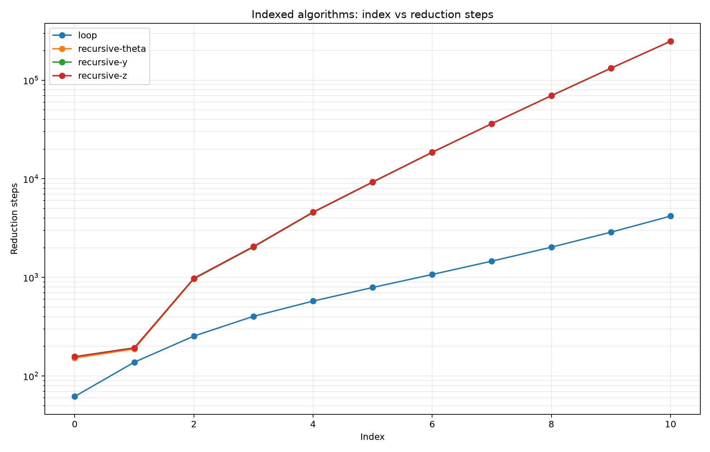

# 斐波那契数列算法比较

## 迭代算法

迭代过程表示为：

$$
\boxed{
\begin{cases}
    P_0 = (0,1) \\
    P_{n+1} = T(P_n) \\
    T(a,b) = (b,a+b) \\
    \operatorname{fib}(n) = \pi_1(P_n)
\end{cases}
}
$$

实现在 [loop.lambda](loop.lambda) 中。

## 递归算法

递归过程表示为：

$$
\boxed{
\operatorname{fib}(n) = \begin{cases}
    0 & n = 0 \\
    1 & n = 1 \\
    \operatorname{fib}(n-1) + \operatorname{fib}(n-2) & n \ge 2 \\
\end{cases}
}
$$

实现在 [recursive-y.lambda](recursive-y.lambda) / [recursive-z.lambda](recursive-z.lambda) / [recursive-theta.lambda](recursive-theta.lambda) 中。分别使用 `Y` 组合子 / `Z` 组合子 / `THETA` 组合子

## 比较并绘图

在仓库根目录运行：

```sh
uv run scripts/compare_index.py examples/fibonacci/compare.json
```

得到的表格为：

[index-vs-steps.csv](index-vs-steps.csv)

得到的图片为：



可知按归约效率来说，迭代会比递归更好。

这个例子看不出三种组合子在归约效率上的区别，因为三条曲线几乎重合了。
