# 有序列表编码

## Church 有序列表

Church 有序列表通过折叠操作来表示数据，适合对列表进行遍历。

Church 有序列表及相关操作实现在 [church.lambda](church.lambda) 中。

### Church 有序列表的构造

Church 有序列表需要两个基本定义：

$$
\boxed{
\begin{aligned}
\mathrm{NIL}_C &= \lambda c.\lambda n.n \\
\mathrm{CONS}_C &= \lambda h.\lambda t.\lambda c.\lambda n.c\ h\ (t\ c\ n)
\end{aligned}
}
$$

二者分别表示空列表和在列表开头插入元素：

$$
\begin{aligned}
\mathrm{NIL}_C &\to [] \\
\mathrm{CONS}_C\ h\ t &\to [h, \ldots t] \\
\end{aligned}
$$

由此可以递归构造出任意列表：

$$
\begin{aligned}
[] &= \mathrm{NIL}_C \\
[i_1] &= \mathrm{CONS}_C\ i_1\ \mathrm{NIL}_C \\
[i_2,i_1] &= \mathrm{CONS}_C\ i_2\ [i_1] \\
[i_3,i_2,i_1] &= \mathrm{CONS}_C\ i_3\ [i_2,i_1]
\end{aligned}
$$

Church 有序列表可用于表示折叠：

- 当 $l=\mathrm{NIL}_C$ 时，$l\ a\ b$ 被归约为

    $$
    \begin{aligned}
    \mathrm{NIL}_C\ a\ b
    &= (\lambda c.\lambda n.n)\ a\ b \\
    &\to b
    \end{aligned}
    $$

- 当 $l=\mathrm{CONS}_C\ i_1\ i_{2:k}$ 时，$l\ a\ b$ 被归约为

    $$
    \begin{aligned}
    (\mathrm{CONS}_C\ i_1\ i_{2:k})\ a\ b
    &= ((\lambda h.\lambda t.\lambda c.\lambda n.c\ h\ (t\ c\ n))\ i_1\ i_{2:k})\ a\ b \\
    &\to (\lambda c.\lambda n.c\ i_1\ (i_{2:k}\ c\ n))\ a\ b \\
    &\to a\ i_1\ (i_{2:k}\ a\ b)
    \end{aligned}
    $$

综上可知：

$$
\boxed{
l\ a\ b
=
\begin{cases}
  b & l = [] \\
  a\ i_1\ (i_{2:k}\ a\ b) & l = [i_1,\ldots i_{2:k}]
\end{cases}
}
$$

继续展开：

$$
i_{2:k}\ a\ b
=
\begin{cases}
  b & i_{2:k} = [] \\
  a\ i_2\ (i_{3:k}\ a\ b) & i_{2:k} = [i_2,\ldots i_{3:k}]
\end{cases}
$$

最终得到：

$$
\boxed{
[i_1,i_2,\ldots,i_k]\ a\ b
=
a\ i_1\ (a\ i_2\ (\cdots(a\ i_k\ b)\cdots))
}
$$

即 $l\ a\ b$ 表示对 $l$ 中的每个元素从右到左依次对当前元素和累计值应用 $a$，而初始累计值为 $b$。

这就是对列表的右折叠：

$$
l\ f\ z
=
\mathrm{foldr}(f,z,l)
=
\begin{cases}
z & l=[]\\
f(x,\mathrm{foldr}(f,z,xs)) & l=x::xs
\end{cases}
$$

### Church 有序列表的操作

以下操作均使用 Binary 自然数作为列表元素和列表索引。

实现 Church 有序列表操作的关键之处，就是把操作本身用一个右折叠表示。

#### Church 有序列表的求和

列表元素的求和可以递归表示为：

$$
\mathrm{sum}(l)
=
\begin{cases}
  0 & l=[] \\
  x+\mathrm{sum}(xs) & l=x::xs
\end{cases} \\
$$

对照右折叠的定义：

$$
\begin{aligned}
z &= 0 \\
f(x,r) &= x+r
\end{aligned}
$$

因此有：

```lambda
@> sum = \l -> l ADD_B ZERO_B;
```

#### Church 有序列表的求积

列表元素的求积可以递归表示为：

$$
\mathrm{prod}(l)
=
\begin{cases}
  1 & l=[] \\
  x\times\mathrm{prod}(xs) & l=x::xs
\end{cases}
$$

对照右折叠的定义：

$$
\begin{aligned}
z &= 1 \\
f(x,r) &= x\times r
\end{aligned}
$$

因此有：

```lambda
@> prod = \l -> l MUL_B ONE_B;
```

#### Church 有序列表的索引

索引访问列表对应位置的元素，索引 $i$ 从零开始计数，越界时返回指定的默认值 $d$：

$$
\mathrm{index}(l, i, d)
=
\begin{cases}
d & l=[] \\
x & l=x::xs \land i=0 \\
\mathrm{index}(xs,i-1,d) & l=x::xs \land i>0
\end{cases}
$$

为了能够得到索引减一的值，需要用以索引为参数的函数作为折叠结果。对照右折叠的定义可知：

$$
\begin{aligned}
z &= \lambda i.d \\
f(x,g)
&= \lambda i.
\begin{cases}
  x & i=0 \\
  g(i-1) & i>0
  \end{cases}
\end{aligned}
$$

把折叠结果应用于索引，就得到了索引处的元素：

```lambda
indexStep = \h -> \r -> \k ->
    IF (ISZERO_B k)
        h
        (r (PRED_B k));
@> index = \l -> \i -> \d ->
    l indexStep (\k -> d) i;
```

#### Church 有序列表的查找

查找从左到右第一个满足 $p$ 的元素，没有匹配时返回默认值 $d$：

$$
\mathrm{find}(l,p,d)
=
\begin{cases}
d & l=[] \\
x & l=x::xs \land p(x) \\
\mathrm{find}(xs,p,d) & l=x::xs \land \neg p(x)
\end{cases}
$$

对照右折叠的定义：

$$
\begin{aligned}
z &= d \\
f(x,r)
&=
\begin{cases}
  x & p(x) \\
  r & \neg p(x)
\end{cases}
\end{aligned}
$$

因此有：

```lambda
findStep = \p -> \h -> \r ->
    IF (p h) h r;
@> find = \l -> \p -> \d ->
    l (findStep p) d;
```

#### Church 有序列表的排序

排序使用升序插入排序，可以递归表示为：

$$
\mathrm{sort}(l)
=
\begin{cases}
[] & l=[] \\
\mathrm{insert}(x,\mathrm{sort}(xs)) & l=x::xs
\end{cases}
$$

由右折叠的定义可知：

$$
\begin{aligned}
z &= [] \\
f(x,r) &= \mathrm{insert}(x,r)
\end{aligned}
$$

因此只要实现 `insert`，便可以写出排序：

```lambda
@> sort = \l -> l insert nil;
```

而插入是将 $x$ 放到有序列表中第一个大于 $x$ 的元素之前：

$$
\mathrm{insert}(x,l)
=
\begin{cases}
  [x] & l=[] \\
  x::y::ys & l=y::ys \land x<y \\
  y::\mathrm{insert}(x,ys) & l=y::ys \land x\ge y
\end{cases}
$$

为了保留未经修改的尾列表，需要用有序对 $(u,g)$ 作为折叠结果，其中 $u$ 是原来的尾列表，$g(x)$ 是把 $x$ 插入原尾列表的结果。对照右折叠的定义可知：

$$
\begin{aligned}
z &= ([],\lambda x.[x]) \\
f(y,(u,g))
&=
\left(y::u,\lambda x.
\begin{cases}
  x::y::u & x<y \\
  y::g(x) & x\ge y
\end{cases}
\right)
\end{aligned}
$$

取折叠结果的第二个分量并应用于 $x$，就得到了插入后的新列表：

```lambda
insertStep = \h -> \state ->
    PAIR
        (cons h (FST state))
        (\x ->
            IF (LT_B x h)
            (cons x (cons h (FST state)))
            (cons h (SND state x)));
insertInit = PAIR nil (\x -> cons x nil);
insert = \x -> \l -> SND (l insertStep insertInit) x;
```

## Scott 有序列表

Scott 有序列表通过选择空列表或非空列表对应的分支来表示数据，适合对列表进行模式匹配和解构。

Scott 有序列表及相关操作实现在 [scott.lambda](scott.lambda) 中。

### Scott 有序列表的构造

Scott 有序列表需要两个基本定义：

$$
\boxed{
\begin{aligned}
\mathrm{NIL}_S &= \lambda c.\lambda n.n \\
\mathrm{CONS}_S &= \lambda h.\lambda t.\lambda c.\lambda n.c\ h\ t
\end{aligned}
}
$$

二者分别表示空列表和在列表开头插入元素：

$$
\begin{aligned}
\mathrm{NIL}_S &\to [] \\
\mathrm{CONS}_S\ h\ t &\to [h, \ldots t]
\end{aligned}
$$

由此可以递归构造出任意列表：

$$
\begin{aligned}
[] &= \mathrm{NIL}_S \\
[i_1] &= \mathrm{CONS}_S\ i_1\ \mathrm{NIL}_S \\
[i_2,i_1] &= \mathrm{CONS}_S\ i_2\ [i_1] \\
[i_3,i_2,i_1] &= \mathrm{CONS}_S\ i_3\ [i_2,i_1]
\end{aligned}
$$

Scott 有序列表可用于表示模式匹配：

- 当 $l=\mathrm{NIL}_S$ 时，$l\ a\ b$ 被归约为

    $$
    \begin{aligned}
    \mathrm{NIL}_S\ a\ b
    &= (\lambda c.\lambda n.n)\ a\ b \\
    &\to b
    \end{aligned}
    $$

- 当 $l=\mathrm{CONS}_S\ i_1\ i_{2:k}$ 时，$l\ a\ b$ 被归约为

    $$
    \begin{aligned}
    (\mathrm{CONS}_S\ i_1\ i_{2:k})\ a\ b
    &= ((\lambda h.\lambda t.\lambda c.\lambda n.c\ h\ t)\ i_1\ i_{2:k})\ a\ b \\
    &\to (\lambda c.\lambda n.c\ i_1\ i_{2:k})\ a\ b \\
    &\to a\ i_1\ i_{2:k}
    \end{aligned}
    $$

综上可知：

$$
\boxed{
l\ a\ b
=
\begin{cases}
  b & l = [] \\
  a\ x\ xs & l = x::xs
\end{cases}
}
$$

即 $l\ a\ b$ 表示：

- 当 $l$ 为空列表时执行 $b$
- 当 $l$ 非空列表时执行 $a\ i_1\ i_{2:k}$，其中 $i_1$ 是首元素而 $i_{2:k}$ 是去除首元素得到的尾列表

### Scott 有序列表的操作

以下操作均使用 Binary 自然数作为列表元素和列表索引。

实现 Scott 有序列表操作的关键之处，就是把操作本身用一个模式匹配表示，并分别处理空列表和非空列表两个分支。

#### Scott 有序列表的求和

列表元素的求和可以递归表示为：

$$
\mathrm{sum}(l)
=
\begin{cases}
0 & l=[] \\
x+\mathrm{sum}(xs) & l=x::xs
\end{cases} \\
$$

因此有：

```lambda
sumStep = \r -> \l ->
    l
        (\h -> \t -> ADD_B h (r t))
        ZERO_B;
@> sum = Y sumStep;
```

#### Scott 有序列表的求积

列表元素的求积可以递归表示为：

$$
\mathrm{prod}(l)
=
\begin{cases}
1 & l=[] \\
x\times\mathrm{prod}(xs) & l=x::xs
\end{cases}
$$

因此有：

```lambda
prodStep = \r -> \l ->
    l
        (\h -> \t -> MUL_B h (r t))
        ONE_B;
@> prod = Y prodStep;
```

#### Scott 有序列表的索引

索引的递归定义为：

$$
\mathrm{index}(l,i,d)=
\begin{cases}
  d & l=[] \\
  x & l=x::xs \land i=0 \\
  \mathrm{index}(xs,i-1,d) & l=x::xs \land i>0
\end{cases}
$$

对于两种分支：

- 空列表分支返回 $d$
- 非空列表分支根据索引 $i$ 是否为零继续选择分支

因此实现为：

```lambda
indexStep = \r -> \l -> \i -> \d ->
    l
        (\h -> \t ->
            IF (ISZERO_B i)
                h
                (r t (PRED_B i) d))
        d;
@> index = Y indexStep;
```

#### Scott 有序列表的查找

查找的递归定义为：

$$
\mathrm{find}(l,p,d)=
\begin{cases}
  d & l=[] \\
  x & l=x::xs \land p(x) \\
  \mathrm{find}(xs,p,d) & l=x::xs \land \neg p(x)
\end{cases}
$$

对于两种分支：

- 空列表分支返回 $d$
- 非空列表分支根据谓词 $p(x)$ 是否成立继续选择分支

因此实现为：

```lambda
findStep = \r -> \l -> \p -> \d ->
    l
        (\h -> \t ->
            IF (p h)
                h
                (r t p d))
        d;
@> find = Y findStep;
```

#### Scott 有序列表的排序

排序的递归定义为：

$$
\mathrm{sort}(l)
=
\begin{cases}
[] & l=[] \\
\mathrm{insert}(x,\mathrm{sort}(xs)) & l=x::xs
\end{cases}
$$

实现为：

```lambda
sortStep = \r -> \l ->
    l
        (\h -> \t -> 
            insert h (r t))
        nil;
@> sort = Y sortStep;
```

插入的递归定义为：

$$
\mathrm{insert}(x,l)
=
\begin{cases}
  [x] & l=[] \\
  x::y::ys & l=y::ys \land x<y \\
  y::\mathrm{insert}(x,ys) & l=y::ys \land x\ge y
\end{cases}
$$

对于两种分支：

- 空列表分支返回 $[x]$
- 非空列表分支根据 $x < y$ 是否成立继续选择分支

因此实现为：

```lambda
insertStep = \r -> \x -> \l ->
    l
        (\h -> \t -> 
            IF (LT_B x h)
                (cons x l)
                (cons h (r x t)))
        (cons x nil);
insert = Y insertStep;
```

## 比较并绘图

在仓库根目录运行：

```sh
uv run scripts/compare/compare_list.py examples/list/compare.json
```

以下比较均使用 Binary 自然数作为列表元素和列表索引。

### 求和比较结果

列表为随机生成的序列，最小值为 `1`，最大值为 `10`。

得到的表格为：

[sum.csv](sum.csv)

得到的图片为：

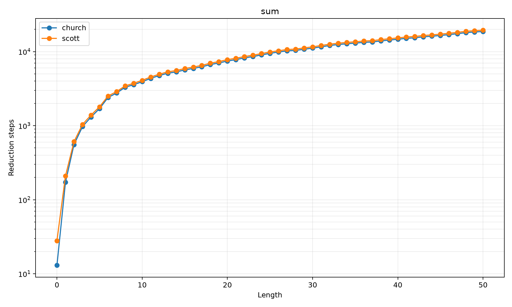

可知在该输入范围内，Church 列表求和的归约步数略少于 Scott 列表。

### 求积比较结果

列表为随机生成的序列，最小值为 `1`，最大值为 `5`。

得到的表格为：

[prod.csv](prod.csv)

得到的图片为：

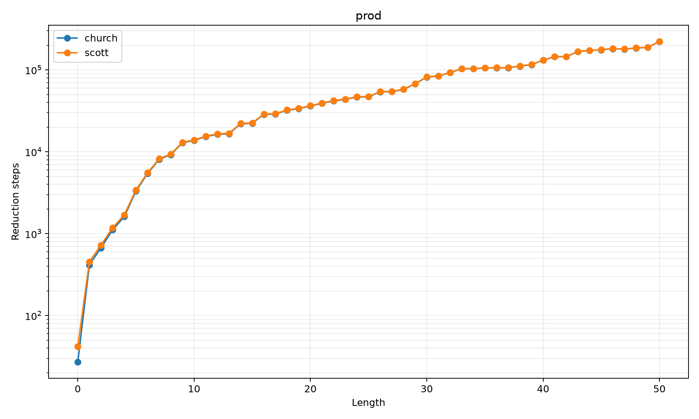

可知在该输入范围内，Church 列表求积的归约步数略少于 Scott 列表。

### 索引比较结果

列表为从 `1` 到长度上限的升序排列，分别访问首项 / 中间项 / 末项。

得到的表格为：

[index-first.csv](index-first.csv)

[index-middle.csv](index-middle.csv)

[index-last.csv](index-last.csv)

得到的图片为：

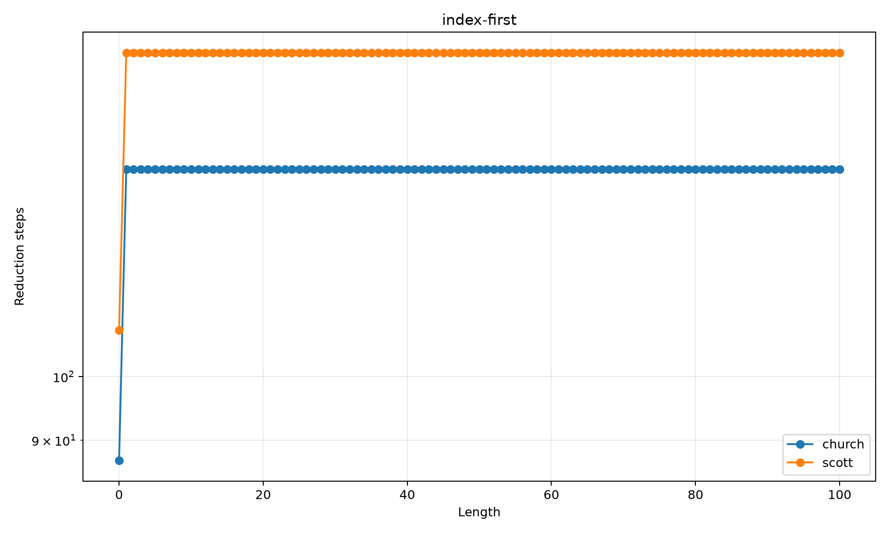

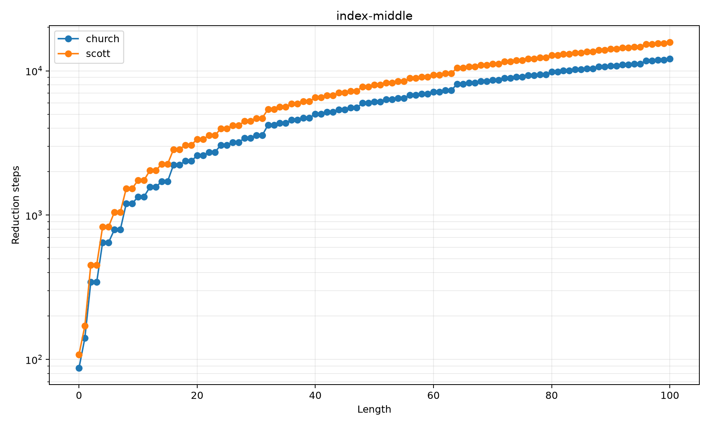

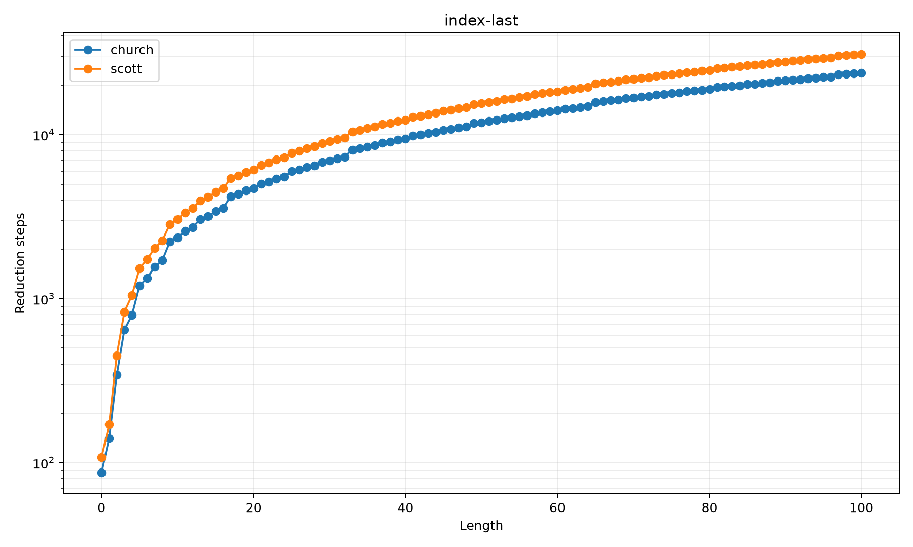

可知对于非空列表：

- 访问首项的归约步数不随列表长度增加
- 访问中间项和末项的归约步数随列表长度增加，且近似呈线性关系

对于索引操作，在这些输入范围内，Church 列表的归约步数少于 Scott 列表。

### 查找比较结果

列表为从 `1` 到长度上限的升序排列，分别查找首项 / 中间项 / 末项。

得到的表格为：

[find-first.csv](find-first.csv)

[find-middle.csv](find-middle.csv)

[find-last.csv](find-last.csv)

得到的图片为：

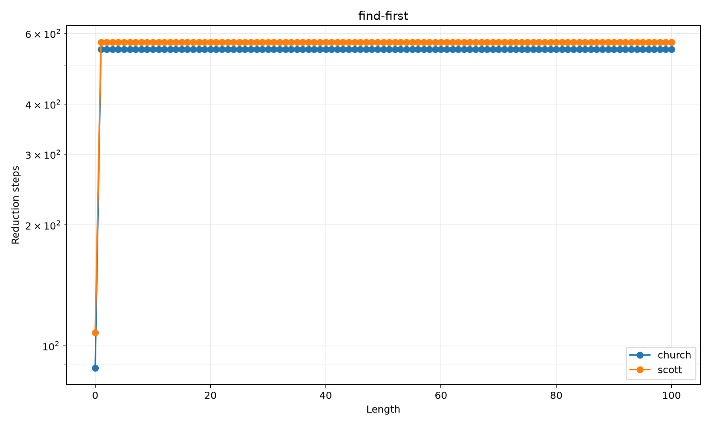

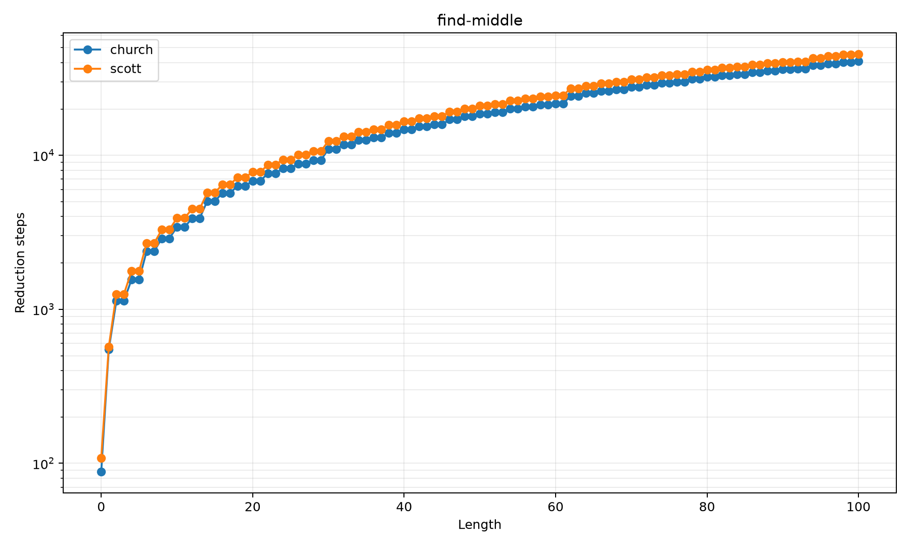

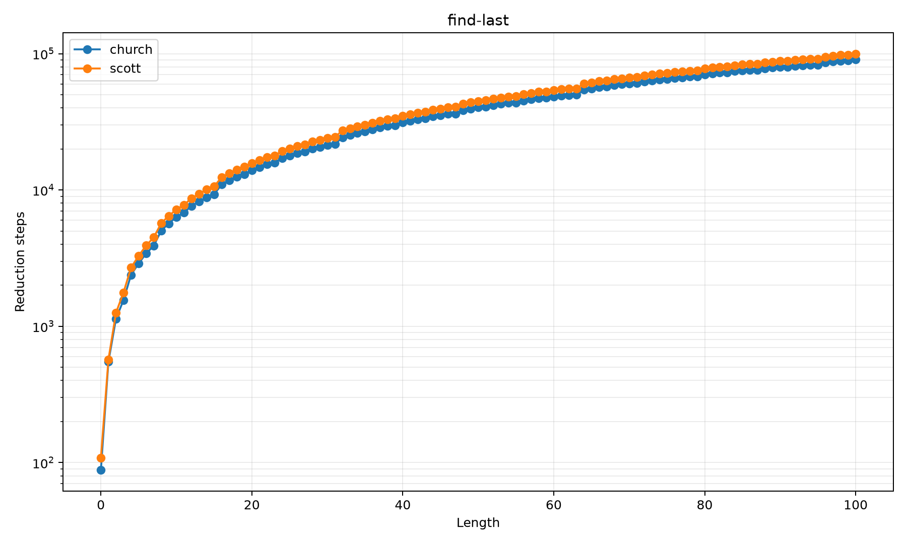

可知对于非空列表：

- 匹配首项时归约步数不随列表长度增加
- 匹配中间项和末项的归约步数随列表长度增加，且近似呈线性关系

对于查找操作，在这些输入范围内，Church 列表的归约步数少于 Scott 列表。

### 排序比较结果

列表分别使用从长度上限到 `1` 的降序排列 / `2,1,2,1,...` 的降序循环 / 最小值为 `1`、最大值为 `1000` 的随机序列。

得到的表格为：

[sort-descending.csv](sort-descending.csv)

[sort-duplicates.csv](sort-duplicates.csv)

[sort-random.csv](sort-random.csv)

得到的图片为：

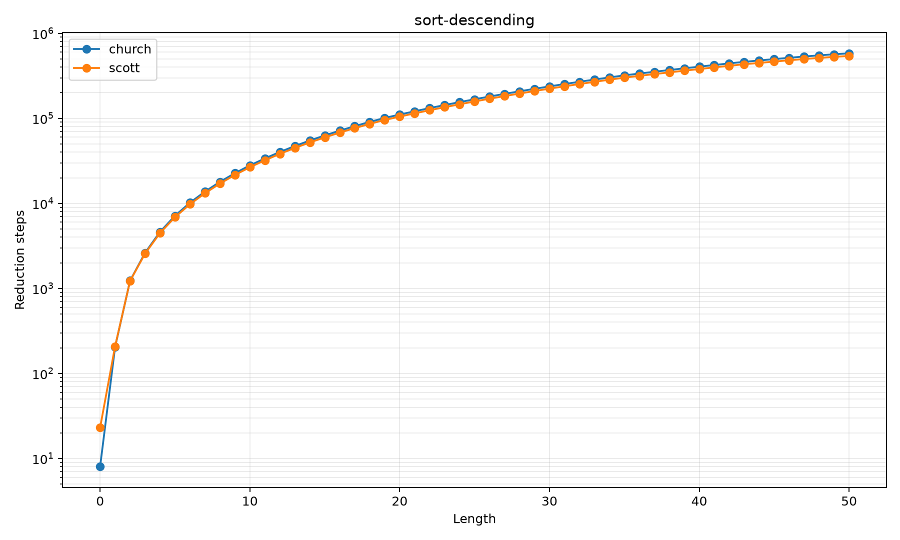

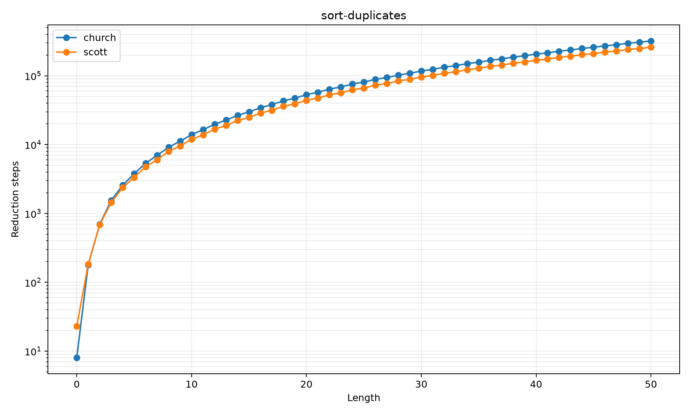

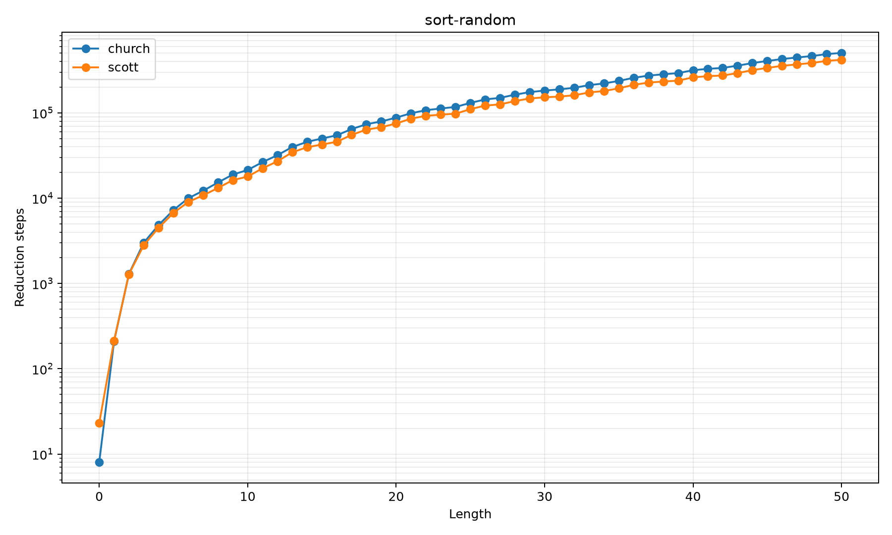

可知对于排序操作，在这些输入范围内，Scott 列表的归约步数少于 Church 列表。
