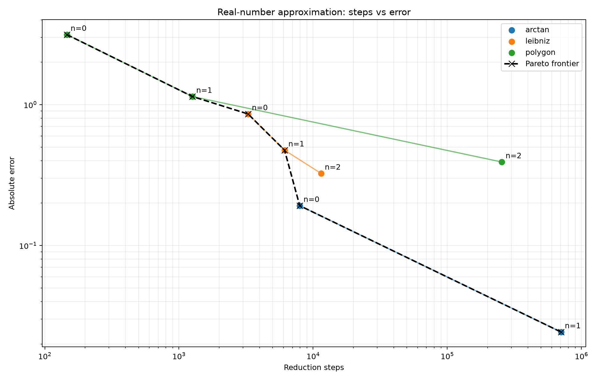

# 圆周率构造算法比较

## 反正切级数构造

第 $n$ 项为：

$$
\boxed{
16\sum_{k=0}^{n}\frac{(-1)^k}{(2k+1)5^{2k+1}}
-
4\sum_{k=0}^{n}\frac{(-1)^k}{(2k+1)239^{2k+1}}
}
$$

实现在 [arctan.lambda](arctan.lambda) 中。

## 莱布尼茨构造

第 $n$ 项为：

$$
\boxed{
4\sum_{k=0}^{n}\frac{(-1)^k}{2k+1}
}
$$

实现在 [leibniz.lambda](leibniz.lambda) 中。

## 正多边形构造

第 $n$ 项为：

$$
\boxed{
2^n\sin\frac{\pi}{2^n}
}
$$

实现在 [polygon.lambda](polygon.lambda) 中。

## 比较并绘图

在仓库根目录运行：

```sh
uv run scripts/compare_real.py examples/pi/compare.json
```

得到的表格为：

[steps-vs-error.csv](steps-vs-error.csv)

得到的图片为：



可知按精度与步数之比来评估，最好的是反正切级数构造算法。
