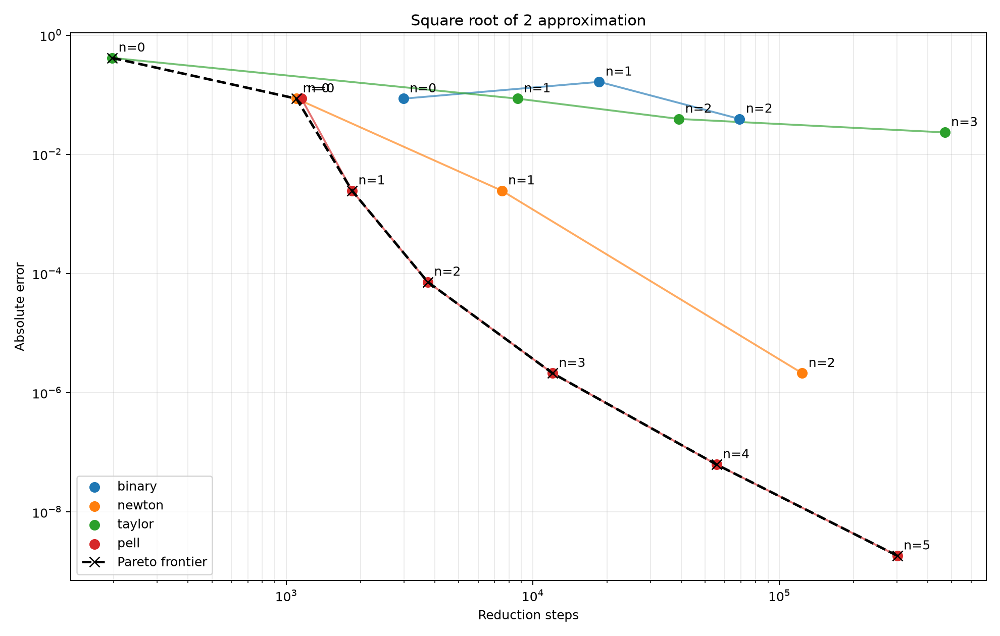

# 实数编码

实数可以基于自然数逐步构造出来。

数学上最经典的构造路线是：

1. 用自然数有序对表示整数
2. 用整数有序对表示有理数
3. 用有理数序列表示实数

## 整数

整数可以通过自然数有序对构造出来。

对于自然数有序对 $(a,b)$，认为其数值上等于 $a-b$。

所有自然数有序对组成的集合可以用笛卡尔积表示为：

$$
\mathbb N\times\mathbb N
=
\Set{
    (a,b)
    |
    a,b\in\mathbb N
}
$$

一个整数可能有多种等价的表示，其等价关系可表示为：

$$
(a,b)\sim(c,d)
\iff
a +_{\mathbb{N}} d = b +_{\mathbb{N}} c
$$

其中 $+_{\mathbb{N}}$ 表示自然数加法。

最终整数就是基于这种等价关系定义的商集：

$$
\boxed{
\mathbb Z
=
\frac{
    \mathbb N\times\mathbb N
}{
    \sim
}
}
$$

## 有理数

有理数可以通过整数有序对构造出来。

对于整数有序对 $(a,b)$，认为其数值上等于 $\frac{a}{b}$，并且额外规定 $b\ne 0$。

所有第二个整数不等于零的整数有序对组成的集合可以表示为：

$$
\mathbb Z\times (\mathbb Z\setminus\set{0})
=
\Set{
    (a,b)
    |
    a,b\in\mathbb Z,
    b\ne 0
}
$$

一个有理数可能有多种等价的表示，其等价关系可表示为：

$$
(a,b)\sim(c,d)
\iff
a \times_{\mathbb{Z}} d = b \times_{\mathbb{Z}} c
$$

其中 $\times_{\mathbb{Z}}$ 表示整数乘法。

最终有理数就是基于这种等价关系定义的商集：

$$
\boxed{
\mathbb Q
=
\frac{
    \mathbb Z\times(\mathbb Z\setminus\set{0})
}{
    \sim
}
}
$$

## 实数

实数可以通过有理数序列构造出来。

对于有理数序列 $a_0, a_1, a_2, \cdots$，认为其数值上等于 $\lim_{n\to\infty} a_n$，并且额外排除极限不存在的情况。

有理数序列可以简写为 $(a_n)$，所有有理数序列组成的集合可以表示为：

$$
\mathbb Q^{\mathbb N}
=
\Set{
    (a_n)
    \mid
    a_n\in\mathbb Q,
    n\in\mathbb N
}
$$

存在极限的有理数序列被称为柯西序列，所有柯西序列组成的集合可以表示为：

$$
\mathcal C
=
\Set{
    (a_n)\in \mathbb{Q}^\mathbb{N}
    |
    \forall\varepsilon\in\mathbb Q_{>0},
    \exists N\in\mathbb N,
    \forall m,n\ge N,
    \lvert a_m -_{\mathbb{Q}} a_n \rvert \lt \varepsilon
}
$$

其中 $-_{\mathbb{Q}}$ 表示有理数减法。

一个实数可能多种等价的表示，其等价关系可表示为：

$$
(a_n)\sim(b_n)
\iff
\forall\varepsilon\in\mathbb Q_{>0},
\exists N\in\mathbb N,
\forall n\ge N,
\lvert a_n -_{\mathbb{Q}} b_n \rvert \lt \varepsilon
$$

最终实数就是基于这种等价关系定义的商集：

$$
\boxed{
\mathbb{R}
=
\frac{
    \mathcal C
}
{
    \sim
}
}
$$

为了更方便计算，可以将有理数序列 $(a_n)$ 视为把自然数映射为有理数的函数 $a: \mathbb{N} \to \mathbb{Q}$，二者之间是一一对应的：

$$
\begin{aligned}
    a(0) &= a_0 \\
    a(1) &= a_1 \\
    \cdots &= \cdots
\end{aligned}
$$

从而有理数序列组成的集合，同构于把自然数映射为有理数的函数组成的集合：

$$
\mathbb{Q}^\mathbb{N}
\cong
\Set{f | f:\mathbb N\to\mathbb Q}
$$

## 示例

柯西序列将实数表示为一系列越来越精确的有理数。因此只需要找到一个算法能够生成逐渐逼近实数精确值的有理数序列，那么就构造出了这个实数。

下面以 $\sqrt{2}$ 的计算作为示例，展示如何构造一个可计算的实数。

### 二分法

实现在 [binary.lambda](binary.lambda) 中。

由于 $1<\sqrt2<2$，取初始有理数区间为：

$$
\boxed{
[a_0,b_0]=[1,2]
}
$$

对 $[a_n, b_n]$ 的迭代，先取中点：

$$
\boxed{
m_n=\frac{a_n+b_n}{2}
}
$$

再对 $m_n$ 进行判断：

- 若 $m_n^2<2$ 成立，则令

  $$
  \boxed{
  a_{n+1}=m_n
  \qquad
  b_{n+1}=b_n
  }
  $$

- 若 $m_n^2<2$ 不成立，则令

  $$
  \boxed{
  a_{n+1}=a_n
  \qquad
  b_{n+1}=m_n
  }
  $$

最后对 $[a_{n+1}, b_{n+1}]$ 重复上述迭代过程。

最终 $(m_n)$ 构成一个逼近 $\sqrt2$ 的有理数序列：

$$
m_0 = \cfrac{3}{2}
\qquad
m_1 = \cfrac{5}{4}
\qquad
m_2 = \cfrac{11}{8}
\qquad
\cdots
$$

### 牛顿迭代法

实现在 [newton.lambda](newton.lambda) 中。

牛顿迭代的公式为：

$$
x_{n+1}
=
x_n-\frac{f(x_n)}{f'(x_n)}
$$

取：

$$
f(x) = x^2-2
$$

计算导数:

$$
f'(x) = 2x
$$

代入得到：

$$
x_{n+1}
=
x_n-\frac{x_n^2-2}{2x_n}
$$

从而递推关系为：

$$
\boxed{
x_{n+1}
=
\frac12\left(x_n+\frac2{x_n}\right)
}
$$

取初始值为：

$$
\boxed{
x_0=\frac32
}
$$

因此 $(x_n)$ 构成一个逼近 $\sqrt2$ 的有理数序列：

$$
x_1=\frac{17}{12}
\qquad
x_2=\frac{577}{408}
\qquad
\cdots
$$

### 泰勒级数法

实现在 [taylor.lambda](taylor.lambda) 中。

泰勒展开的公式为：

$$
f(x)
=
\sum_{n=0}^{\infty}
\frac{f^{(n)}(a)}{n!}(x-a)^n
$$

特别地，当 $a=0$ 时：

$$
f(x)
=
\sum_{n=0}^{\infty}
\frac{f^{(n)}(0)}{n!}x^n
$$

取：

$$
\begin{aligned}
a &= 0 \\
f(x) &= (1+x)^{1/2}
\end{aligned}
$$

计算导数:

$$
f^{(n)}(0)
=
\begin{cases}
    1 & n = 0\\
    \frac{(-1)^{n-1}(2n-3)!!}{2^n} & n \ge 1
\end{cases}
$$

代入得到：

$$
(1+x)^{1/2}
=
1 + \sum_{n=1}^{\infty}
\frac{(-1)^{n-1}(2n-3)!!}{2^n n!}x^n
$$

即：

$$
(1+x)^{1/2}
=
1+
\frac x2-
\frac{x^2}{8}+
\frac{x^3}{16}-
\frac{5x^4}{128}+
\cdots
$$

取 $x=1$，令前 $n+1$ 项的部分和为：

$$
\boxed{
S_n
=
\begin{cases}
    1 & n = 0 \\
    1+\sum_{i=1}^{n}\frac{(-1)^{i-1}(2i-3)!!}{2^i i!} & n \ge 1
\end{cases}
}
$$

从而 $(S_n)$ 构成一个有理数序列。

### 佩尔方程法

实现在 [pell.lambda](pell.lambda) 中。

对于标准佩尔方程：

$$
p^2-2q^2=1
$$

如果整数 $p,q$ 满足这个方程，那么：

$$
\left(\frac pq\right)^2
=
2+\frac1{q^2}
$$

当 $q$ 趋向于无穷大时：

$$
\lim_{q\to\infty}
\frac pq
=
\sqrt2
$$

标准佩尔方程的最小正整数解为：

$$
(p,q)=(3,2)
$$

因此迭代的初始值为：

$$
\boxed{
\begin{aligned}
p_0 &= 3\\
q_0 &= 2
\end{aligned}
}
$$

把 $a=3,b=2,c=p,d=q$ 代入平方差恒等式 $(ac+2bd)^2-2(ad+bc)^2=(a^2-2b^2)(c^2-2d^2)$，得到：

$$
(3p+2\cdot 2q)^2-2(2p+3q)^2
=
(3^2-2\cdot2^2)(p^2-2q^2)
$$

再代入标准佩尔方程 $p^2-2q^2=1$，得到：

$$
(3^2-2\cdot2^2)(p^2-2q^2)
=
1
$$

所以：

$$
(3p+4q)^2-2(2p+3q)^2
=
1
$$

因此如果 $(p,q)$ 是标准佩尔方程的整数解，那么 $(3p+4q,2p+3q)$ 也是标准佩尔方程的整数解。从而可以用前一个解递推构造后一个解：

$$
\boxed{
\begin{aligned}
p_{n+1}&=3p_n+4q_n\\
q_{n+1}&=2p_n+3q_n
\end{aligned}
}
$$

易知 $(p_n)$ 和 $(q_n)$ 都是单调递增的整数序列，所以：

$$
\begin{aligned}
q_n &\ne 0 \\
\lim_{n\to\infty} q_n &= +\infty
\end{aligned}
$$

两个序列逐项相除就得到了 $\sqrt2$ 的有理数逼近序列：

$$
\boxed{
x_n
=
\frac{p_n}{q_n}
}
$$

## 比较并绘图

在仓库根目录运行：

```sh
uv run scripts/compare_real.py examples/real/compare.json
```

得到的表格为：

[steps-vs-error.csv](steps-vs-error.csv)

得到的图片为：



因此，按精度与步数之比来评估，最好的是佩尔方程法，其次是牛顿迭代法。

曲线大致符合对于收敛速度的分析：

| 算法       | 收敛速度 | 典型误差               |
| :--------- | :------- | :--------------------- |
| 二分法     | 线性收敛 | $e_n\leq2^{-n}$        |
| 牛顿迭代法 | 二次收敛 | $e_{n+1}=O(e_n^2)$     |
| 泰勒级数法 | 代数收敛 | $e_n=O(n^{-1/2})$      |
| 佩尔方程法 | 指数收敛 | $e_n=O((3-2\sqrt2)^n)$ |

不过由于采样的点数较少，因此趋势不是很明显。
