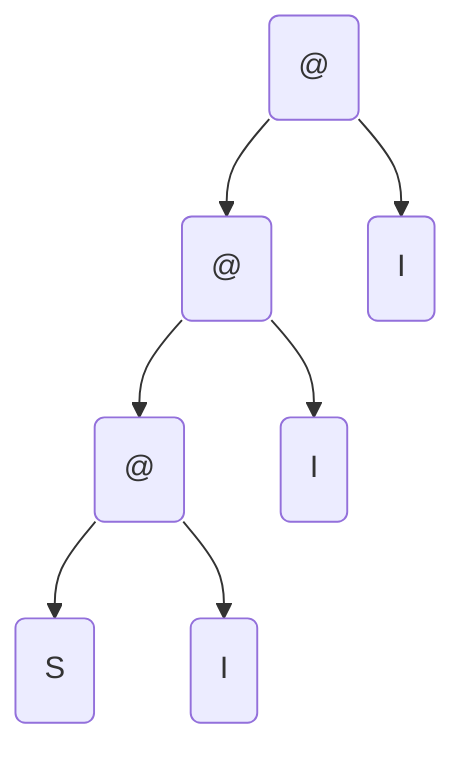
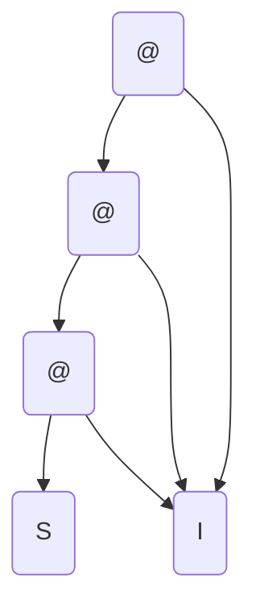
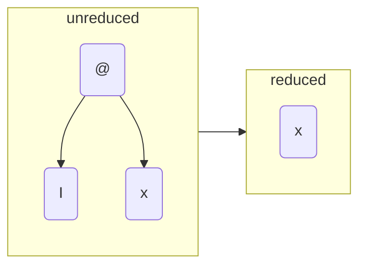
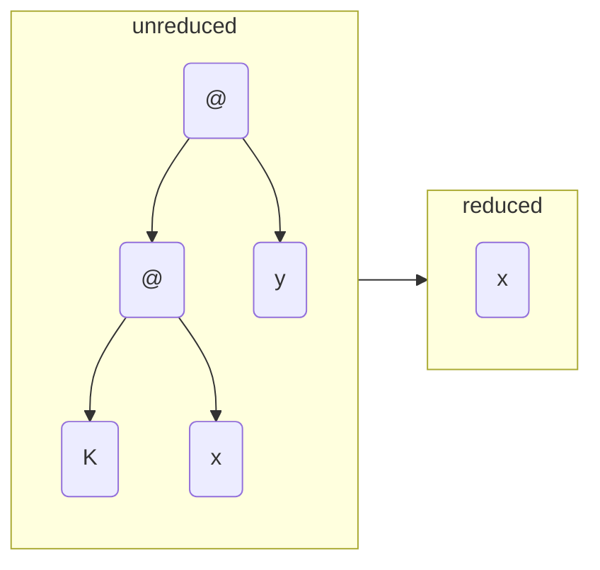
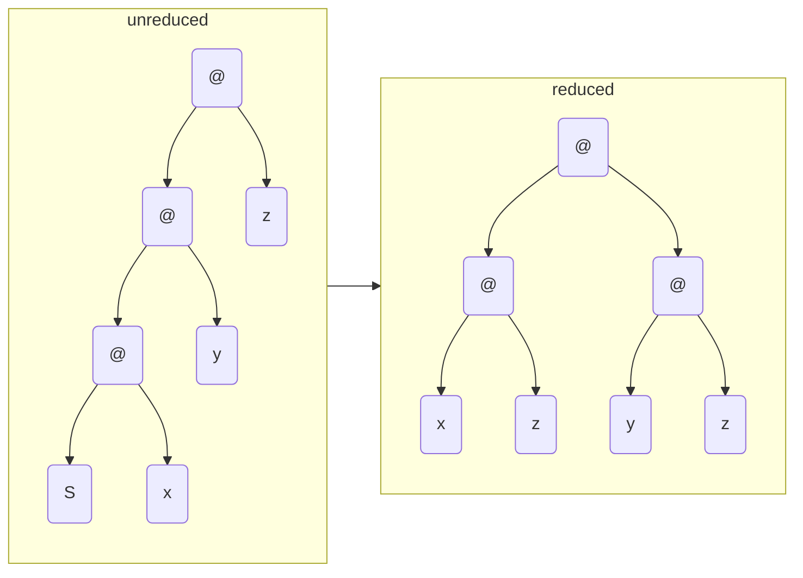

# SKI 图

SKI 组合子是图灵完备的，即只用 S、K、I 三个组合子以及函数应用就可以表示任意可计算程序。

SKI 组合子和 λ 演算都可以模拟任意图灵机。因此可以把由 λ 演算组成的表达式编译为由 SKI 组合子组成的图。

## S 组合子

S 组合子用 λ 演算表示为

$$
S
=
\lambda f.\lambda g. \lambda x.f\ x\ (g\ x)
$$

函数应用的规则为

$$
\boxed{
S\ x\ y\ z
\longrightarrow
x\ z\ (y\ z)
}
$$

## K 组合子

K 组合子用 λ 演算表示为

$$
K
=
\lambda x. \lambda y.x
$$

函数应用的规则为

$$
\boxed{
K\ x\ y
\longrightarrow
x
}
$$

## I 组合子

I 组合子用 λ 演算表示为

$$
I
=
\lambda x.x
$$

函数应用的规则为

$$
\boxed{
I\ x
\longrightarrow
x
}
$$

并且有

$$
S\ K\ K\ x
\longrightarrow K\ x\ (K\ x)
\longrightarrow x
$$

即

$$
\boxed{
S\ K\ K = I
}
$$

## SKI 图结构

SKI 图包含四种节点：`@` 应用节点、`S` 节点、`K` 节点、`I` 节点。

如果不考虑共享节点，那么 SKI 图其实是一棵二叉树：

- 根节点是应用节点，固定有两条出边，分别连接到函数节点和参数节点
- 内部节点是应用节点，固定有一条入边和两条出边，入边连接到根节点或别的内部节点，出边分别连接到函数节点和参数节点
- 叶节点是 `S` 节点 / `K` 节点 / `I` 节点，固定有一条入边，连接到根节点或内部节点



如果考虑共享节点，那么 SKI 图是一个有序有向无环图，因为多个应用节点的出边可能连接到同一个节点，这可以用来减少图的大小



## SKI 图归约

图归约的基本规则为：把应用节点替换为函数节点应用到参数节点上的结果。

如果函数节点是 `I` 节点，参数节点是 `x`，那么得到的结果为 `x`。由于 `I` 组合子只需要一个参数，所以不需要向上回溯节点



如果函数节点是 `K` 节点，参数节点是 `x` 和 `y`，那么得到的结果为 `x`。由于 `K` 组合子需要两个参数，所以需要向上回溯一个节点



如果函数节点是 `S` 节点，参数节点是 `x` / `y` / `z`，那么得到的结果为 `(x z) (y z)`。由于 `S` 组合子需要三个参数，所以需要向上回溯两个节点



## 示例

比较 S、K、I 组合子分别编译得到的 SKI 图

```sh
echo "@! S;" | lambda-compiler > examples/ski/s.ski
echo "@! K;" | lambda-compiler > examples/ski/k.ski
echo "@! I;" | lambda-compiler > examples/ski/i.ski
```

验证 `S K K` 等价于 `I`

```sh
echo "@! S K K;" | lambda-compiler --enable-reduce=both > examples/ski/skk.ski
```

比较不同自然数编码编译得到的 SKI 图

```sh
echo "@! \f -> \x -> f x;" | lambda-compiler > examples/ski/church.ski
echo "@! \z -> \s -> z;" | lambda-compiler > examples/ski/scott.ski
```

比较不同自然数编码在归约后再编译得到的 SKI 图

```sh
echo "@! \f -> \x -> f x;" | lambda-compiler --enable-reduce=beta > examples/ski/church-beta.ski
echo "@! \f -> \x -> f x;" | lambda-compiler --enable-reduce=eta > examples/ski/church-eta.ski
echo "@! \f -> \x -> f x;" | lambda-compiler --enable-reduce=both > examples/ski/church-both.ski
echo "@! \z -> \s -> z;" | lambda-compiler --enable-reduce=beta > examples/ski/scott-beta.ski
echo "@! \z -> \s -> z;" | lambda-compiler --enable-reduce=eta > examples/ski/scott-eta.ski
echo "@! \z -> \s -> z;" | lambda-compiler --enable-reduce=both > examples/ski/scott-both.ski
```
