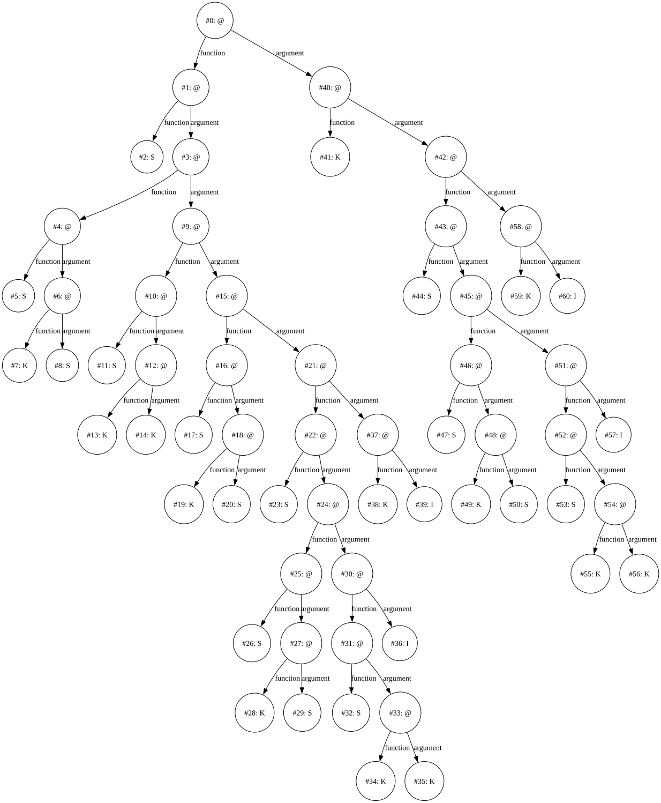
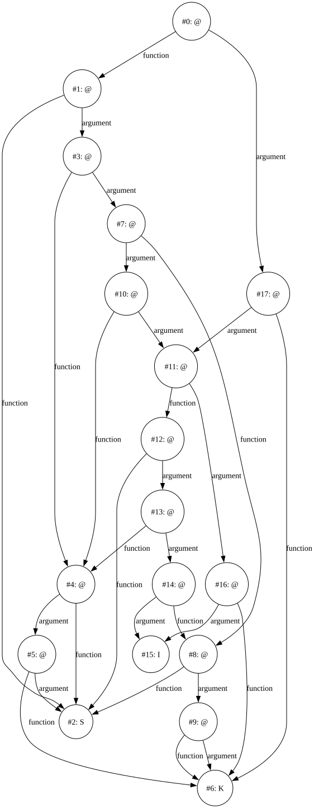

# SKI 图

SKI 组合子是图灵完备的，即只用 S、K、I 三个组合子以及函数应用就可以表示任意可计算程序。

SKI 组合子和 λ 演算都可以模拟任意图灵机。因此可以把由 λ 演算组成的表达式编译为由 SKI 组合子组成的图。

## S 组合子

S 组合子用 λ 演算表示为

$$
S
=
\lambda f.\lambda g. \lambda x.f\ x\ (g\ x)
$$

函数应用的规则为

$$
\boxed{
S\ x\ y\ z
\longrightarrow
x\ z\ (y\ z)
}
$$

## K 组合子

K 组合子用 λ 演算表示为

$$
K
=
\lambda x. \lambda y.x
$$

函数应用的规则为

$$
\boxed{
K\ x\ y
\longrightarrow
x
}
$$

## I 组合子

I 组合子用 λ 演算表示为

$$
I
=
\lambda x.x
$$

函数应用的规则为

$$
\boxed{
I\ x
\longrightarrow
x
}
$$

并且有

$$
S\ K\ K\ x
\longrightarrow K\ x\ (K\ x)
\longrightarrow x
$$

即

$$
\boxed{
S\ K\ K = I
}
$$

## SKI 图结构

SKI 图包含四种节点：`@` 应用节点、`S` 节点、`K` 节点、`I` 节点。

如果不考虑共享节点，那么 SKI 图其实是一棵二叉树：

- 根节点是应用节点，固定有两条出边，分别连接到函数节点和参数节点
- 内部节点是应用节点，固定有一条入边和两条出边，入边连接到根节点或别的内部节点，出边分别连接到函数节点和参数节点
- 叶节点是 `S` 节点 / `K` 节点 / `I` 节点，固定有一条入边，连接到根节点或内部节点

```dot
digraph {
    graph [
        ordering=out,
        bgcolor=transparent,
        label="unshared",
        labelloc=t,
    ]
    node [shape=circle]
    0 [label="@"]
    1 [label="@"]
    2 [label="@"]
    3 [label="S"]
    4 [label="I"]
    5 [label="I"]
    6 [label="I"]
    0 -> 1
    0 -> 6
    1 -> 2
    1 -> 5
    2 -> 3
    2 -> 4
}
```

如果考虑共享节点，那么 SKI 图是一个有向无环图，因为多个应用节点的出边可能连接到同一个节点，这可以用来减少图的大小

```dot
digraph {
    graph [
        ordering=out,
        bgcolor=transparent,
        label="shared",
        labelloc=t,
    ]
    node [shape=circle]
    0 [label="@"]
    1 [label="@"]
    2 [label="@"]
    3 [label="S"]
    4 [label="I"]
    0 -> 1
    0 -> 4
    1 -> 2
    1 -> 4
    2 -> 3
    2 -> 4
}
```

## SKI 图归约

图归约的基本规则为：把应用节点替换为函数节点应用到参数节点上的结果。

如果函数节点是 `I` 节点，参数节点是 `x`，那么得到的结果为 `x`。由于 `I` 组合子只需要一个参数，所以不需要向上回溯节点

```dot
digraph {
    graph [
        ordering=out,
        bgcolor=transparent,
        rankdir=TB,
        newrank=true,
        compound=true,
        nodesep=1.0,
    ]
    node [shape=circle]
    subgraph cluster_before {
        label="unreduced"
        u0 [label="@"]
        u1 [label="I"]
        u2 [label="x"]
        u0 -> u1
        u0 -> u2
    }
    subgraph cluster_after {
        label="reduced"
        r0 [label="x"]
    }
    { rank=source; u0; r0; }
    u0 -> r0 [
        ltail=cluster_before,
        lhead=cluster_after,
    ]
}
```

如果函数节点是 `K` 节点，参数节点是 `x` 和 `y`，那么得到的结果为 `x`。由于 `K` 组合子需要两个参数，所以需要向上回溯一个节点

```dot
digraph {
    graph [
        ordering=out,
        bgcolor=transparent,
        rankdir=TB,
        newrank=true,
        compound=true,
        nodesep=1.0,
    ]
    node [shape=circle]
    subgraph cluster_before {
        label="unreduced"
        u0 [label="@"]
        u1 [label="@"]
        u2 [label="y"]
        u3 [label="K"]
        u4 [label="x"]
        u0 -> u1
        u0 -> u2
        u1 -> u3
        u1 -> u4
    }
    subgraph cluster_after {
        label="reduced"
        r0 [label="x"]
    }
    { rank=source; u0; r0; }
    u0 -> r0 [
        ltail=cluster_before,
        lhead=cluster_after,
    ]
}
```

如果函数节点是 `S` 节点，参数节点是 `x` / `y` / `z`，那么得到的结果为 `(x z) (y z)`。由于 `S` 组合子需要三个参数，所以需要向上回溯两个节点

```dot
digraph {
    graph [
        ordering=out,
        bgcolor=transparent,
        rankdir=TB,
        newrank=true,
        compound=true,
        nodesep=1.0,
    ]
    node [shape=circle]
    subgraph cluster_before {
        label="unreduced"
        u0 [label="@"]
        u1 [label="@"]
        u2 [label="z"]
        u3 [label="@"]
        u4 [label="y"]
        u5 [label="S"]
        u6 [label="x"]
        u0 -> u1
        u0 -> u2
        u1 -> u3
        u1 -> u4
        u3 -> u5
        u3 -> u6
    }
    subgraph cluster_after {
        label="reduced"
        r0 [label="@"]
        r1 [label="@"]
        r2 [label="@"]
        r3 [label="x"]
        r4 [label="z"]
        r5 [label="y"]
        r6 [label="z"]
        r0 -> r1
        r0 -> r2
        r1 -> r3
        r1 -> r4
        r2 -> r5
        r2 -> r6
    }
    { rank=source; u0; r0; }
    u0 -> r0 [
        ltail=cluster_before,
        lhead=cluster_after,
    ]
}
```

## 示例

### 编译后的图

S、K、I 组合子分别编译得到的 SKI 图

```sh
echo "@! S;" | lambda-compiler > examples/ski/s.ski
echo "@! K;" | lambda-compiler > examples/ski/k.ski
echo "@! I;" | lambda-compiler > examples/ski/i.ski
```

λ 抽象编译得到的 SKI 图

```sh
echo "@! \f -> \x -> f x;" | lambda-compiler > examples/ski/church.ski
echo "@! \z -> \s -> z;" | lambda-compiler > examples/ski/scott.ski
```

### 归约后的图

验证 `S K K` 等价于 `I`

```sh
echo "@! S K K;" | lambda-compiler --enable-reduce=beta > examples/ski/reduce-compile.ski
echo "@! S K K;" | lambda-compiler | ski-interpreter > examples/ski/compile-reduce.ski
```

[reduce-compile.ski](reduce-compile.ski) 是 β 归约后再编译得到的 SKI 图，[compile-reduce.ski](compile-reduce.ski) 是编译后再 β 归约得到的 SKI 图。二者结构不同，但功能是等价的。

### 共享后的图

```sh
echo "@! S K K;" | lambda-compiler | ski-interpreter --share=merge > examples/ski/merge.ski
```

对比 [compile-reduce.ski](compile-reduce.ski) 和 [merge.ski](merge.ski) 可以发现，图的节点明显变少了，因为相同的节点被共享了。

```sh
ski-interpreter examples/ski/merge.ski --share=unfold > examples/ski/unfold.ski
```

对比 [merge.ski](merge.ski) 和 [unfold.ski](unfold.ski) 可以发现，图的节点明显变多了，因为共享节点又被重新展开了。

### 可视化图

查看 [s.ski](skk.ski) 输出的 Graphviz DOT 文本，保存在 [s.dot](s.dot) 中：

```sh
ski-interpreter --output=graphviz examples/ski/s.ski > examples/ski/s.dot
```

如果安装了 `dot` 工具，那么可以将其渲染为 SVG 图片：

```sh
ski-interpreter --output=graphviz examples/ski/s.ski | dot -Tsvg -o examples/ski/s-preserve.svg
ski-interpreter --share=merge --output=graphviz examples/ski/s.ski | dot -Tsvg -o examples/ski/s-merge.svg
```

未启用共享节点的图片为：



启用共享节点的图片为：


